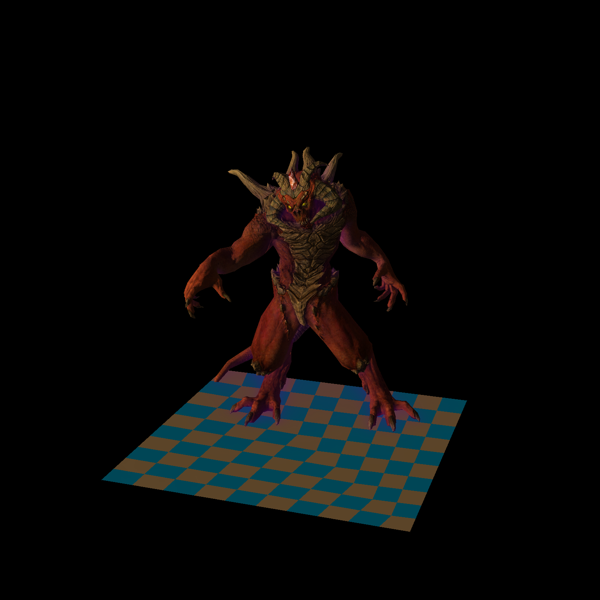
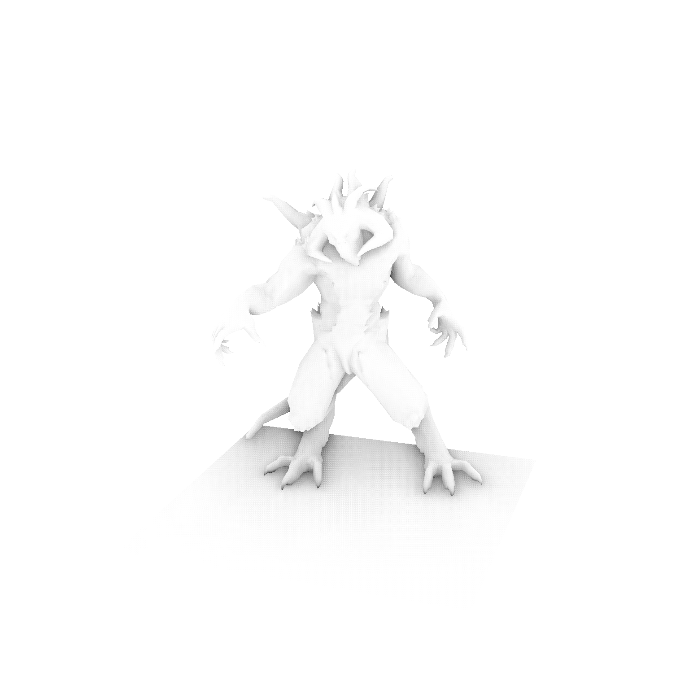
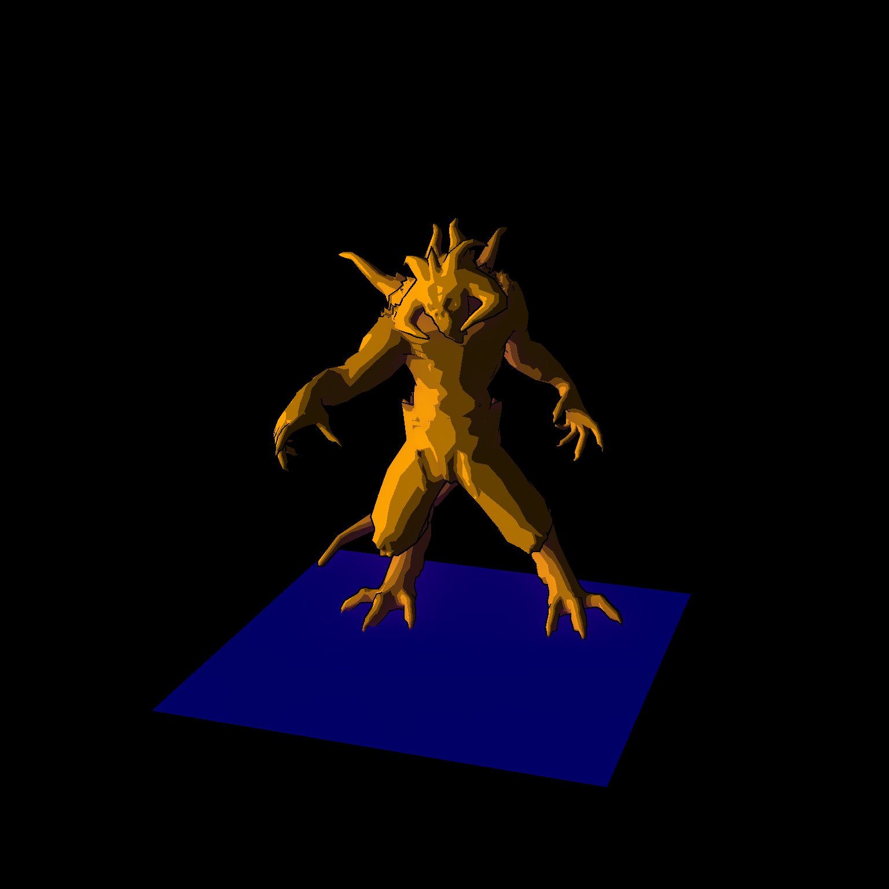
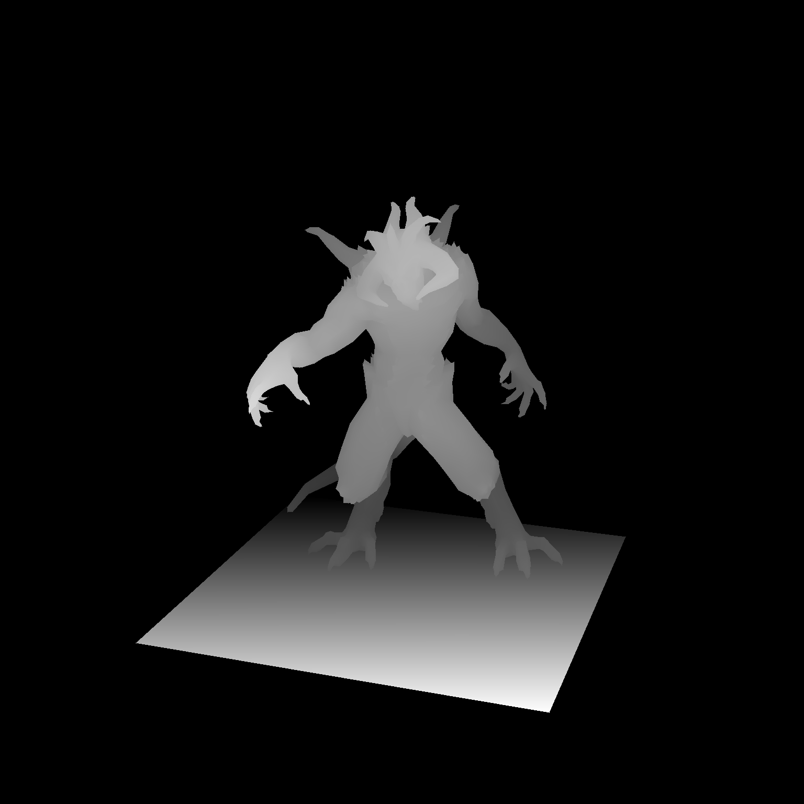
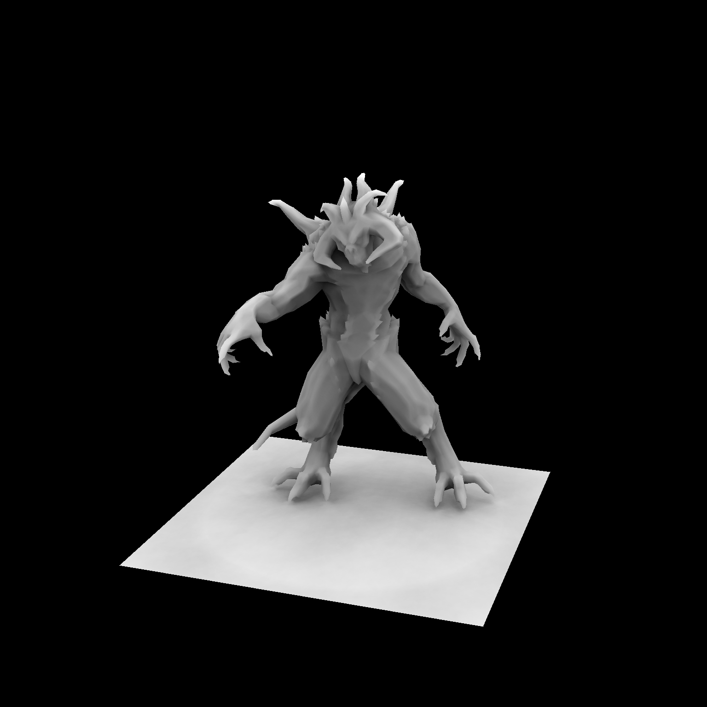
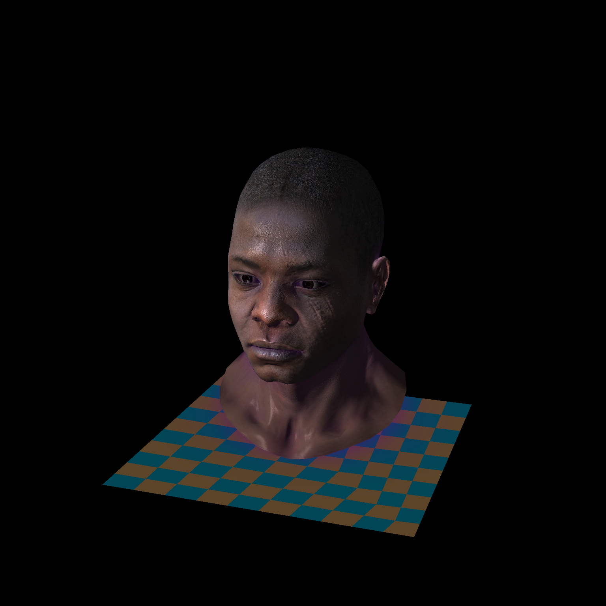
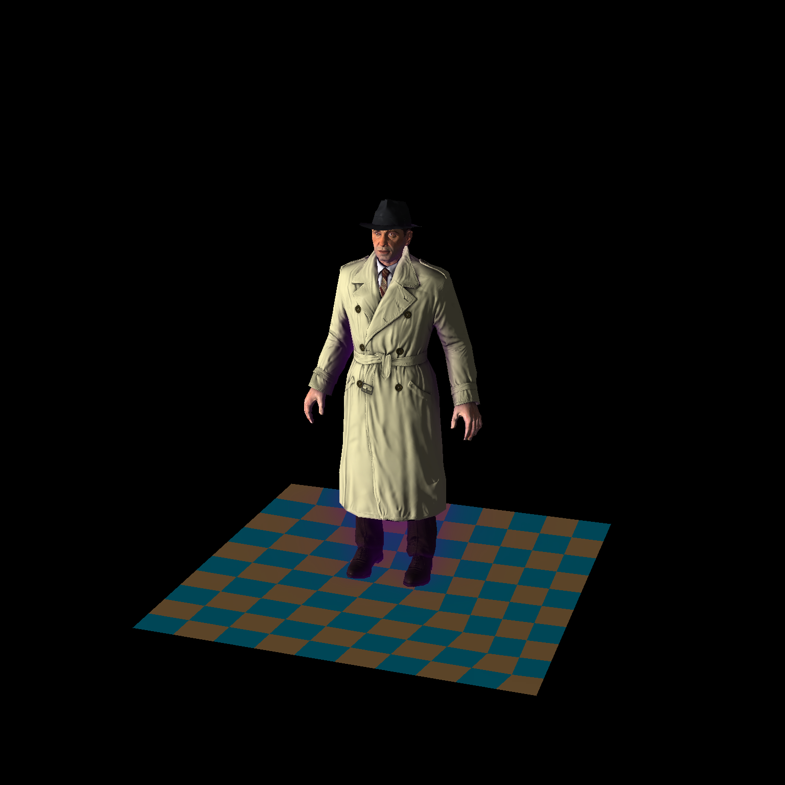

# SimpleRenderer: CPU-based 3D Software Renderer

**SimpleRenderer** — это высокопроизводительный программный рендерер на C++, написанный с нуля. Проект демонстрирует реализацию полного графического конвейера без использования GPU, полагаясь исключительно на вычисления центрального процессора.


## Технические особенности (Key Features)

### Освещение и Шейдеры

* **Tangent Space Normal Mapping:** Реализация попиксельного рельефа с использованием матриц **TBN** (Tangent, Bitangent, Normal) для корректного преобразования векторов в мировое пространство.



* **SSAO (Screen Space Ambient Occlusion):** Динамическое затенение в экранном пространстве. Использует полусферное ядро из 128 выборок и буфер глубины для расчета окклюзии.
*Визуализация SSAO Buffer:*



* **Toon/Cel Shading:** Стилизованный рендеринг с квантованием освещенности и пост-процессингом на основе фильтра Собеля для детекции границ и создания контуров.



### Ядро системы (Core Engine)

* **Barycentric Rasterizer:** Оптимизированный растеризатор, использующий барицентрические координаты для интерполяции атрибутов вершин. Распараллелен с помощью **OpenMP** для повышения производительности.
*Z-Buffer (Визуализация глубины):*



* **AO & Shadow Mapping:** Поддержка **Brute-force AO** (1000 лучей на пиксель) в качестве эталона для сравнения с SSAO.
*AO Brute-force:*



* **CLI Interface:** Гибкая настройка сцены через аргументы командной строки: загрузка нескольких моделей, настройка цветов, освещения и выбор шейдера.

### Описание технических деталей

* **TBN Matrix:** Реализована генерация касательного пространства для каждой вершины, что позволяет использовать карты нормалей в пространстве касательных, обеспечивая корректное освещение при любой ориентации модели в мировых координатах.
* **SSAO Logic:** Используется полусферическое ядро из 128 выборок с весовым затуханием и случайным поворотом вектора шума для устранения эффекта «полос».
* **Post-Processing Pipeline:** После основного прохода рендеринга применяется фильтр Собеля по буферу глубины для создания стилизованной обводки и выполняется размытие для сглаживания теней SSAO.

### Другие модели

Рендеры моделей из `obj/` с Tangent Space Normal Mapping и SSAO:

| African Head | Boggie |
| --- | --- |
|  |  |

Авторы моделей: [Samuel Sharit — Diablo](obj/diablo3_pose/readme.txt), [Vidar Rapp — African Head](obj/african_head/readme.txt), [Bojana Nedeljković — Boggie](obj/boggie/readme.txt).


### Полный список аргументов командной строки

| Флаг | Описание | Значение по умолчанию |
| --- | --- | --- |
| `-m` | Пути к одной или нескольким моделям (.obj) | `obj/diablo3_pose/diablo3_pose.obj` |
| `-shader` | Тип шейдера: `toon`, `gouraud`, `phong`, `tangentspace`, `wireframe`, `solid`, `random` | `toon` |
| `-ao` | Метод затенения: `ssao`, `bruteforce` или `none` | `ssao` |
| `-c` | Список цветов для моделей (например, `gold`, `red`, `white`) | `orange` |
| `-l` | Вектор направления света `x y z` | `-1.5 0.5 1.5` |
| `-w` / `-s` | Ширина и высота выходного изображения | `2048x2048` |


## Сборка и запуск

### Требования

* Компилятор с поддержкой **C++20** (MSVC, GCC или Clang).
* **CMake** (версия 3.12+).
* **OpenMP** (рекомендуется для распараллеливания расчетов SSAO и растеризации).

### Сборка

```bash
# Генерация файлов сборки
cmake -Bbuild

# Компиляция (на Linux/macOS добавьте -j для ускорения)
cmake --build build --config Release

```

### Примеры запуска

Программа поддерживает гибкую настройку через флаги.

**Windows (PowerShell):**

```powershell
# Запуск с SSAO и Tangent Space Normal Mapping
./build/Release/simplerenderer.exe -m obj/diablo3_pose/diablo3_pose.obj -shader tangentspace -ao ssao -c gold

# African Head с отдельной моделью глаз
./build/Release/simplerenderer.exe -m obj/african_head/african_head.obj obj/african_head/african_head_eye_inner.obj -shader tangentspace -ao ssao

```

**Linux:**

```bash
# Boggie: тело, голова и глаза загружаются вместе
./build/simplerenderer -m obj/boggie/body.obj obj/boggie/head.obj obj/boggie/eyes.obj -shader tangentspace -ao ssao

```

### Обновление изображений README

Все семь изображений сохранены в [`docs/images/`](docs/images/) в формате PNG (1536 × 1536). Относительные ссылки работают в клоне репозитория и на GitHub без привязки к аккаунту автора.

После сборки их можно заново получить скриптом [`tools/render_readme.py`](tools/render_readme.py). Нужны Python 3, Pillow и исходные текстуры `.tga` рядом с моделями в `obj/` (сейчас эти текстуры исключены из Git правилом `*.tga`).

```powershell
python -m pip install Pillow
python tools/render_readme.py build/Release/simplerenderer.exe
```

Для Linux или сборки Ninja передайте путь к соответствующему исполняемому файлу: `build/simplerenderer` или `build/simplerenderer.exe`. Размер можно изменить флагом `--size 1024`.

Скрипт запускает пять сцен, сохраняет промежуточные TGA и логи в `build/readme-renders/`, затем переводит результаты в PNG без изменения цветов. Буферы SSAO и глубины взяты из того же запуска, что и основной кадр Diablo; brute-force AO использует 1000 направлений. Из-за случайных выборок AO при повторном запуске возможны небольшие отличия.
